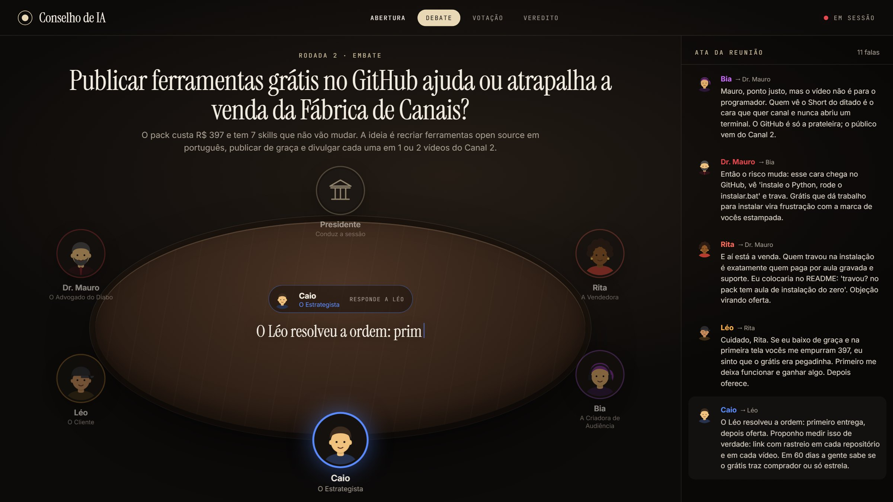
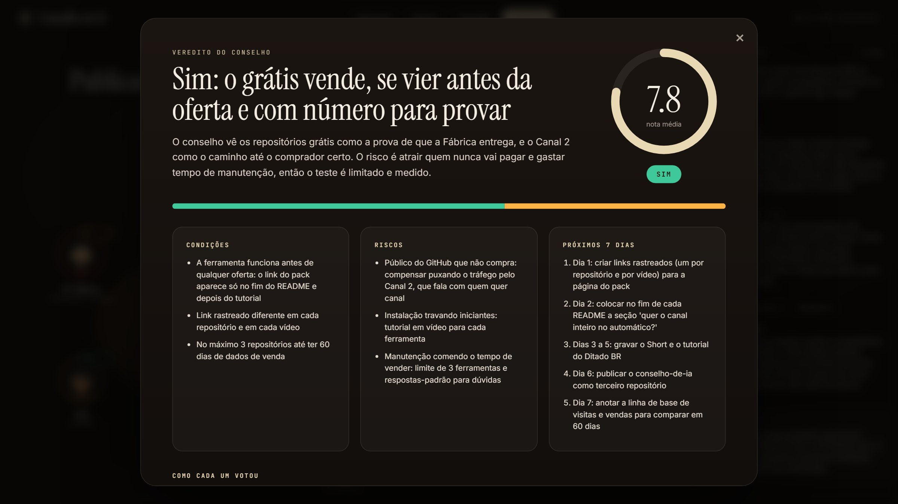
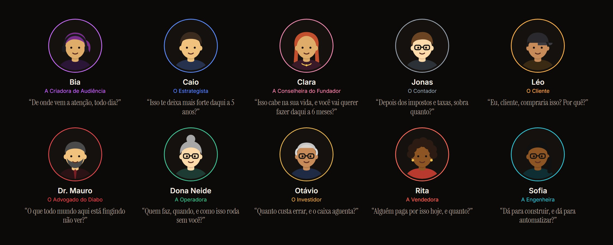

<div align="center">


<a href="https://sparks-gamesstudio.github.io/fabrica-de-canais/"></a>

**Leve uma decisão difícil para um conselho de 10 especialistas de IA. Eles debatem ao vivo numa mesa, discordam de verdade, votam e entregam o veredito com plano de 7 dias.**

<p>
  
  
  
  
</p>

<p>
  <a href="#instalacao"></a>
  <a href="https://sparks-gamesstudio.github.io/fabrica-de-canais/github.html"></a>
  
</p>



</div>

## 👋 O Rebite explica


> Sabe quando você pergunta pra uma IA e ela só concorda contigo? Aqui é o contrário. Dez conselheiros, cada um com a sua mania, brigam pela sua decisão até sair um veredito. É tipo ter uma diretoria inteira de bolso.

<br clear="right" />

## 🪑 Como funciona

No Claude Code, escreva:

```
/conselho devo largar meu emprego para viver do meu canal? hoje ganho 4 mil e o canal fatura 1.200 por mês
```

1. **O Presidente monta o conselho:** escolhe de 4 a 6 conselheiros que mais importam para a sua decisão e coloca na mesa pelo menos dois que vão discordar.
2. **A mesa abre no navegador** e o debate acontece ao vivo, uma fala por vez, em 3 rodadas: primeiras impressões, embate (um rebate o outro pelo nome) e proposta final.
3. **Cada um vota** sim, não ou "sim, com condições", com nota de 0 a 10 e o motivo.
4. **Sai o veredito:** decisão, nota média, condições, riscos, próximos 7 dias e um relatório em PDF.



## 🧑‍⚖️ Os 10 conselheiros

Personagens fictícios, cada um com uma prioridade, um jeito de falar e um viés assumido. É justamente o atrito entre eles que mostra o que você não estava vendo.



Quer outro conselheiro? Crie um arquivo em `conselheiros/` seguindo o modelo dos outros (nome, pergunta-chave, como pensa, como fala, cor e retrato). Ele já pode sentar à mesa na próxima sessão.

<a id="instalacao"></a>

## ⬇️ Instalação

Precisa do [Claude Code](https://claude.com/claude-code) e do Python 3.10+. Não precisa instalar nenhum pacote.

```bash
git clone https://github.com/sparks-gamesstudio/conselho-de-ia.git
```

Copie a pasta para `~/.claude/skills/conselho` (no Windows: `C:\Users\<você>\.claude\skills\conselho`) e peça `/conselho` seguido da sua decisão.

Quer ver antes de usar? Rode o conselho de exemplo e clique em **Reassistir o debate**:

```bash
python scripts/mesa.py demo
```

## 🎁 O que você leva

- **A ata completa** do debate, ao lado da mesa.
- **Um relatório em PDF** ([exemplo](docs/relatorio-exemplo.pdf)) com decisão, votos e plano, pronto para mostrar ao sócio ou guardar.
- **Reassistir:** o debate inteiro de novo, encenado, ótimo para gravar a tela e postar.

## 🔍 Por dentro

| Arquivo | O que faz |
|---|---|
| `SKILL.md` | como o Presidente conduz: escolha do conselho, regras de cada fala, votação e veredito |
| `conselheiros/*.md` | as 10 fichas: quem é, como pensa, como fala, que viés tem |
| `scripts/mesa.py` | registra cada fala e voto e serve a mesa em `localhost:4747` (só Python padrão) |
| `mesa/` | a sala: mesa, retratos ilustrados, ata, veredito e relatório para impressão |

## ⚠️ Aviso honesto

<table>
<tr>
<td width="110" align="center"></td>
<td>

Os conselheiros são personagens criados por IA. São ótimos para enxergar ângulos, riscos e testes baratos, mas não substituem contador, advogado, médico ou planejador financeiro de verdade.

</td>
</tr>
</table>

## 🙏 Créditos

Inspirado no [Roast Room](https://github.com/nateherkai/roast-room), que traz conselheiros baseados em pessoas reais. Aqui os conselheiros são personagens originais, o código foi escrito do zero e tudo foi pensado para quem empreende no Brasil.

---

<div align="center">

<a href="https://sparks-gamesstudio.github.io/fabrica-de-canais/"></a>

Feito pela **[Fábrica de Canais](https://sparks-gamesstudio.github.io/fabrica-de-canais/)**, skills de Claude Code para canais de vídeo no piloto automático.

<a href="https://instagram.com/afabricadecanais"></a>
<a href="https://github.com/sparks-gamesstudio"></a>

<sub>Licença MIT · use, modifique e compartilhe. Se ajudou, deixa uma ⭐</sub>


</div>
